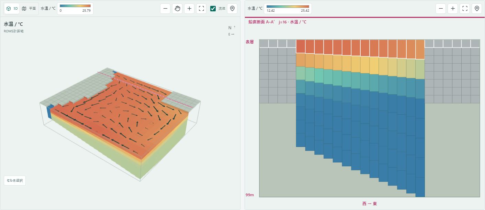
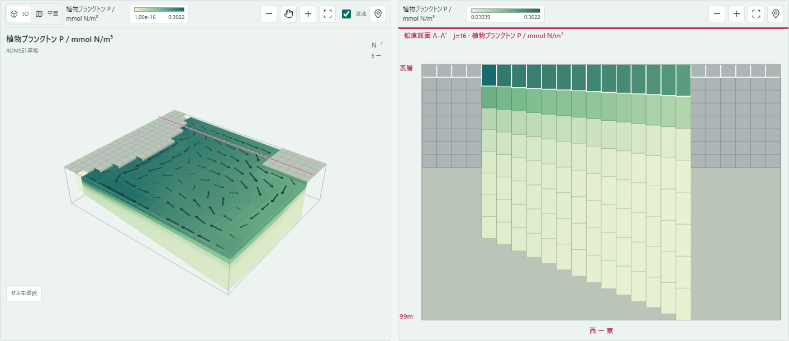
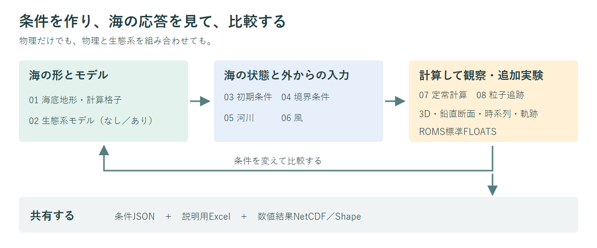
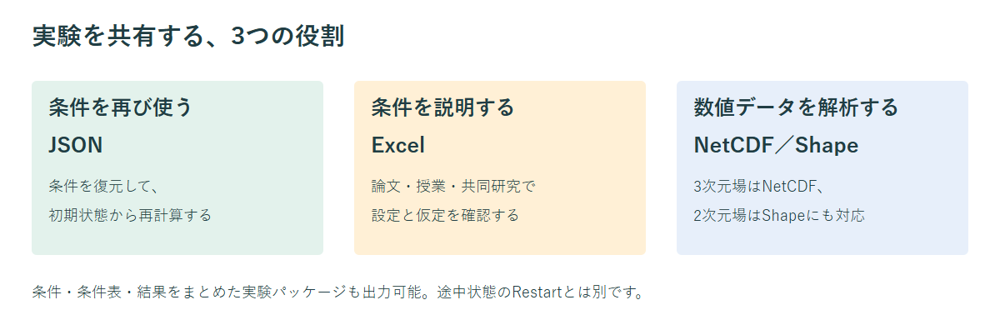

# WebROMS

**海洋シミュレーションを、専門の計算環境から、誰もが試せる実験の場へ。**

WebROMSは、海の地形・水温・塩分・流れ・生物濃度を設定し、ブラウザー内で実際のROMSを動かすアプリです。**８工程で海洋場を作り、計算し、粒子を放流して輸送を調べる**ところまで、一つの環境で進められます。条件を変えたときに海がどう応答するかを、3D図・鉛直断面・時系列で確かめられます。

*同梱した実験条件によるROMS計算例です。実海域の観測再現や定常到達を示すものではありません。[例の条件と図の説明](docs/README_EXAMPLES.md)。*

## 何が変わるのか

海洋モデルでは、物理や生物の知識に加え、計算環境の構築、格子・入力ファイルの準備、結果の可視化が必要になります。WebROMSは、その一連の作業を一つの画面につなぎ、**「まず条件を変えて、海の応答を見る」までの距離を短くする**ことを目指しています。

| 従来のモデル利用で必要になりやすい作業 | WebROMSが提供する入口 |
| --- | --- |
| 計算用OS・コンパイラー・実行環境の準備 | コンパイル済みROMSを内包し、Windowsのブラウザーで実行 |
| 格子・初期値・外力などの個別ファイル作成 | 地形から外力までを設定し、その場で図を確認 |
| 物理モデルと生態系モデルの設定を横断して理解 | 物理のみ／NPZD／NEMUROを選び、反応の図と式も確認 |
| 計算結果を別のツールへ移して可視化 | 計算中から3D・断面・層別・深度別・時系列を比較 |
| 他の人に実験条件を説明・受け渡し | 条件JSON、説明用Excel、数値結果を用途別に共有 |

新しい海洋方程式を提案する製品ではありません。**既存のROMSをブラウザーに内包し、設定・理解・計算・可視化・共有を一続きにする設計**が中心です。数値モデルを使うための情報技術上の負担を減らしますが、物理・生物の仮定や結果を吟味する必要性は変わりません。

## どんな実験ができるか

- **地形と流れ**：湾、沿岸、大洋、理想化した水槽で、地形や回転・風が流れに与える影響を調べる。
- **成層と混合**：夏季の成層・冬季の混合、熱交換、鉛直混合の条件差を、水平場と鉛直断面で比べる。
- **河川と境界**：淡水や栄養塩の流入、閉鎖・開放接続、海面高度・潮汐強制による違いを試す。４境界の平均潮位と計算期間を確認し、大潮・小潮相当の期間を含む実験を考える。
- **物理と生態系の関係**：NPZD／NEMUROの反応・輸送を計算し、水温・混合・流れと生物濃度を同じ実験で見る。
- **粒子の輸送**：計算後の海洋場からROMS標準FLOATSで受動粒子を複数地点から放流し、地点ごとの色で移動を比較する。3D・平面には粒子の位置を表示し、時系列の軌跡はNetCDFで保存する。魚の行動モデルは含まない。
- **条件比較と共有**：条件を保存し、別の人が同じ配布版で初期状態から再計算できる形で渡す。

*生物濃度はNPZDによるモデル出力です。色範囲は各図に表示しています。詳細と再実行用条件は [計算例](docs/README_EXAMPLES.md) に記載しています。*

## 使う場面

| 利用者・場面 | 活用の例 | 得られるもの |
| --- | --- | --- |
| 高校・大学の授業 | 風や成層を変え、結果を比較する演習 | 設定と現象を結びつけて考える機会 |
| 観測中心の物理・生物研究者 | 観測で見えた現象の条件を単純化して試す | 仮説の整理、共同研究での共通の実験条件 |
| モデルを学び始める学生 | 初期値・境界・外力・反応係数を段階的に理解 | 計算環境の準備に先立ってモデルに触れる入口 |
| 水産試験場・行政・環境分野 | 流入や混合などの条件差を探索する | 専門家との検討に使える図と条件表 |
| モデル研究者 | 理想化ケースの試行、授業・共同研究への配布 | 条件と結果を説明・共有する共通の画面 |

**現地予測、行政判断、設計・評価業務にそのまま使える精度を保証するものではありません。** 実海域での利用には入力データの整合性、解像度、安定性、観測との比較などの検証が必要です。

## 構成とワークフロー

地形と格子を決め、計算する生態系を選び、海の初期状態と外からの入力を与えて計算します。物理だけの実験にも、生態系を組み合わせた実験にも対応します。

| 工程 | 決めること・見ること |
| --- | --- |
| **01 海底地形** | 同梱／独自の地形、計算格子、河口の配置 |
| **02 生態系モデル** | 生態系なし／NPZD／NEMURO、反応とパラメータ |
| **03 初期条件** | 水温・塩分・生物濃度の初期分布 |
| **04 境界条件** | 側面からの入力、海面高度、潮汐 |
| **05 河川の設定** | 河川ごとの流入先・流量・水温・塩分・生物濃度 |
| **06 風の強制力** | 一様風・理想化パターン・NOAA気候値 |
| **07 定常計算** | 計算期間・熱交換・回転・混合、結果の観察と保存 |
| **08 追加実験** | 複数地点からの粒子放流・追跡、放流元を区別した保存 |

計算の後は、結果を観察して条件を変えるか、条件と数値データを共有します。08の追加実験は、07の終了状態をそのまま引き継いで粒子を追跡します。終了状態はブラウザー内に一時保持し、初期条件からの再計算は行いません。各実験は同じ終了状態から始められます。潮汐強制がある場合は約24.84時間の固定波形・振幅を繰り返す理想化実験です。保存済み流速を使うオフライン追跡ではなく、保存したファイルから別セッションで再開する機能もありません。**設定→実行→観察→比較**の繰り返しを中心にした構成です。

潮汐のある実験では、日数・累計時間・終了日とともに、東西南北それぞれの境界平均潮位を時系列で確認できます。位相の違いを分けて見ながら、実験に含まれる潮汐の周期を検討できます。大潮・小潮相当の表示は潮差による目安で、月齢や実地点の観測を保証するものではありません。

*粒子は海洋場とともに時間を進めて追跡します。設定JSONは放流条件を含みますが、計算済み状態は含みません。具体的な操作は [利用ガイド](docs/USER_GUIDE.md#7-追加実験で粒子を追跡する) を参照してください。*

画面は設定と可視化を担当し、計算はブラウザー内のWorkerとROMS WASMが担当します。利用者がLinux環境や計算サーバーを用意する必要はありません。細かなモジュール、数値計算の選択構成、検証範囲は [技術概要](docs/TECHNICAL_OVERVIEW.md) に分けています。

## 実験をどう渡すか

**JSONは条件の復元、Excelは条件の説明、NetCDF／Shapeは数値データの受け渡し**に使います。条件・条件表・結果をまとめた実験パッケージも出力できます。

**独自の地形を読み込んだ実験も、条件JSONだけで共有できます。** JSONには計算格子へ変換した水深・陸域・座標範囲と設定が含まれ、受取側に元のShape／NetCDFファイルは不要です。同じWebROMS配布版で地形と条件を復元し、初期状態から再計算できます。元データの全解像度・全属性や計算結果を保管するものではありません。データの再配布条件は別途確認してください。

保存した条件の読み込みは、計算途中へのRestartではなく、初期状態からの再実行です。通常計算ではファイルを自動保存せず、終了後に指定した期間・間隔の追加RUNで結果を保存します。未保存の設定は終了・再読み込みで破棄します。

## 知っておいてほしいこと

- **ROMSを使う選択構成です。** 直交格子、2〜15層の等間隔sigma層、静水圧近似、固定陸域などの制約があります。
- **「計算完了」は定常到達ではありません。** 指定ステップの完了であり、時間変化・収支・安定性は利用者が確認します。
- **地域名と観測再現は別です。** 同梱地形・気候値は解像度や平均化の制約を持ち、湾内の細かな現象を保証しません。
- **実データと仮定値を区別します。** FES潮汐実データは未同梱で、未入力時の理想化潮汐は実地点の予測ではありません。
- **検証は限定したケースです。** ネイティブ版ROMSとの比較やブラウザー操作のテストは、すべての海域・設定の正しさを保証しません。

詳しい制約・入力データ・検証記録は [技術概要](docs/TECHNICAL_OVERVIEW.md) に記載しています。

## 次に読む

| 知りたいこと | 文書 |
| --- | --- |
| 起動と実際の操作 | [画面付き利用ガイド](docs/USER_GUIDE.md)・[Windows起動ガイド](WINDOWS.md) |
| 図に使った実験条件 | [READMEの計算例](docs/README_EXAMPLES.md) |
| 計算エンジン・数値モデル・入出力・検証 | [技術概要](docs/TECHNICAL_OVERVIEW.md) |
| 8工程それぞれの仕様 | [WORKFLOW.md](WORKFLOW.md) |
| 地形・気候値・風・地理入力と潮汐 | [地形](TERRAIN.md)・[気候値](CLIMATOLOGY.md)・[風など](FORCING.md)・[地理入力](OCEAN_INPUTS.md) |
| 開発と詳細なアーキテクチャ | [技術概要の開発節](docs/TECHNICAL_OVERVIEW.md#4-検証開発配布)・[設計文書](BROWSER_ROMS_DESIGN.md) |

## ライセンス

アプリは [MIT](LICENSE) です。ROMS等の第三者コードと同梱データには、それぞれの利用条件があります。公開・再配布では [第三者ライセンス](THIRD_PARTY_NOTICES.md) と [データの出典・注意事項](docs/TECHNICAL_OVERVIEW.md#出典と利用条件) を確認してください。
