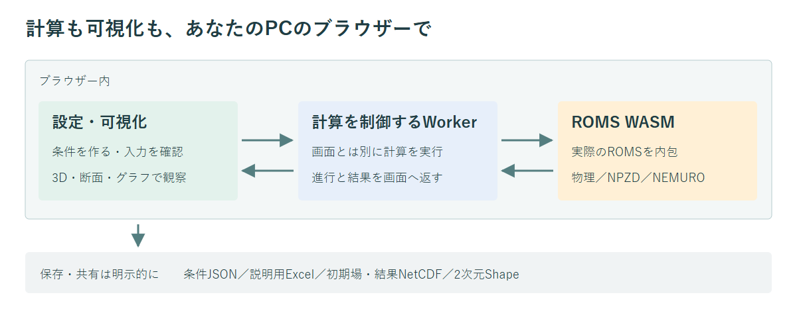

# WebROMS 技術概要

[README](../README.md) は製品の全体像、この文書は計算構成・近似・データ・保存・検証の説明です。実際の操作は [利用ガイド](USER_GUIDE.md) を参照してください。

## 1. 計算エンジン



| 担当 | 技術と役割 |
| --- | --- |
| 設定・可視化 | JavaScript、Three.js、Canvas。入力チェック、3D・平面・断面・時系列 |
| 計算の制御 | Web Worker。実行、進行通知、表示用状態の受け渡し、追加保存RUN |
| 数値計算 | Flang／EmscriptenでWASM化したROMSのFortranコード。代替JavaScriptソルバーは不使用 |
| 入出力 | WASM内のNetCDF入出力、2次元Shape ZIP、条件JSON、説明用Excel |

ROMS 4.3、コミット `57aecf589a408b1e5490d2db7f9bd0196062a44e` に基づきます。物理・NPZD・NEMUROと固定混合／GLS混合の組合せで計6種類の核を同梱します。GLS核は `runtime/gls/` にあります。[実行核のmanifest](../runtime/manifest.json) にハッシュ・ツールチェーンを記録しています。

Worker・WASMにはHTTP配信が必要で、HTMLの直接オープンは対象外です。Windowsランチャーは標準PowerShellで配信物を準備し、ローカル配信します。利用者向け起動にNode.js・pnpmは不要です。

詳細設計：[BROWSER_ROMS_DESIGN.md](../BROWSER_ROMS_DESIGN.md)

## 2. 数値モデルと反応系

### 物理と格子

海面高度、3次元流速、温度・塩分、移流、水平・鉛直拡散、陸域のC格子マスクをROMSが計算します。現在は直交格子、2〜15等分sigma層、固定陸域、静水圧近似の選択構成です。設定水深は最大10,000 mです。

海面淡水フラックスはゼロ、底面は線形抵抗です。河川は沿岸陸セルに隣接する内部海セルへの体積源として与えます。閉鎖水槽への流入は水位を上昇させます。

濡れ乾き、入れ子格子、任意のROMSコンパイルオプション、Restart、KINACOは未対応です。急峻な海底、不整合な境界、過大な時間刻みなどで発散し得ます。

### 熱交換・回転・混合

熱交換は「なし／気温から／フラックスから」の排他的な選択です。気温方式は `Q = λ(Tair − SST)`、λの既定値は20 W/(m² K)。気温は時間・空間一様、SSTは各セルの計算中の水温です。湿度・潜熱・長波放射を個別に扱う気象学的バルク式ではなく理想化熱交換です。

直接フラックスはQをW/m²で与え、正を加熱、負を冷却とします。気温方式を重ねて加算しません。ROMSには `Q/(ρ₀Cp)` を与え、ρ₀=1025 kg/m³、Cp=3985 J/(kg K)です。生物反応用短波放射とは別の設定です。熱交換の既定・旧設定は「なし」です。

新規設定の回転は緯度方式です。`f₀ = 2Ω sin φ₀`、β平面では `β = 2Ω cos φ₀/R`、f平面ではβ=0です。係数の直接指定も選べます。模擬成層では混合強度で躍層の位置・厚さを変え、各層内の平均値を与えます。

新規設定の鉛直混合はGLS（k-ε、Canuto A）。成層・せん断・風応力等に応じた乱流のパラメータ化で、乱流の直接解像ではありません。背景係数は水温・塩分・生物・粘性とも0.0001 m²/s。水平係数は一定です。

高度な設定で鉛直係数を固定値へ切り替えます。旧JSONに `numerics.calculateDiffusion` がない場合は従来の固定値で読み込みます。追加保存RUNも選択した方式を引き継ぎます。

式と仮定：[FORCING.md](../FORCING.md)

### 生態系

| モデル | 状態量 | 反応係数 | 基礎となる設定 |
| --- | --- | --- | --- |
| NPZD (Franks) | 4 | 13 | ROMS `npzd_Franks.in` |
| NEMURO | 11 | 84 | ROMS `nemuro.in` |

ROMS本体で反応・移流・拡散・沈降を時間積分します。NEMUROの摂餌は `IVLEV_EXPLICIT`。初期濃度のみ `roms/sample/NEMURO.BOX.f90` のA7サンプルをmol/Lからmmol/m³へ換算した値です。サンプルの全反応式や全係数を移植したものではありません。

生物トレーサーの外部海面・海底フラックスはゼロ、粒子は各モデルの速度で沈降します。NEMUROの海面短波放射は時間・空間一様です。生態系OFFでは物理専用WASMを使います。

mg表記はRedfield C:N:P=106:16:1の元素相当量で、乾燥重量ではありません。Chlからの推定ではC:Chl、Z/P、D/Pなどの仮定を使います。

### 追加実験：粒子追跡

08はROMS標準 `FLOATS` のオンライン積分です。07終了後のWASM内の海洋場を保持したまま追加RUNし、3次元Lagrangian粒子または一定深度のGeopotential粒子を追跡します。ROMSのMilne予測・Hamming修正法と格子上の流速補間を使い、JavaScriptで粒子移流を代替していません。[ROMSソース](https://github.com/myroms/roms) の `step_floats.F`・`interp_floats.F` に基づきます。

複数の内部水域セルから、合計最大512粒子を各セル内へ分散して放流します。地点ごとに粒子数・深度・色を指定できます。表示は粒子の現在位置と色が同期する丸頭の放流ピンのみで、軌道線は描きません。ランダムウォーク、魚の行動・成長、粒子への生物反応は未対応です。閉鎖境界や海岸での挙動はROMS標準処理に依存し、人工的な反射・海岸補正を追加していません。領域を出た粒子は出力のstatusで区別します。

粒子の位置を3D・平面で確認し、時間×粒子のNetCDFを手動保存します。深度は基準海面から下向き正です。各実験は07終了時刻に固定し、ROMS標準の `PERFECT_RESTART` NetCDFと短周期結合の平均海面・流量・運動量強制を保持する補助バイナリから、独立したWASMへ直接状態を読み込みます。初期条件からの再積分は行いません。内部時間積分インデックスを復元し、鉛直座標を保持した平均海面から再生成します。元の実行核は進めません。一時データはブラウザー内のMEMFSとメモリだけで保持し、終了・再読み込み・新しい海洋計算で破棄します。利用者が保存・配布するRestart機能ではありません。境界強制は開始後に約24.84時間の１周期を固定して繰り返し、終点と始点の差を線形に除いて周期接続します。MDTは維持します。周期・開始時刻・出典はNetCDFの `experiment_config.tide`、開始方法は `experiment_config.startMethod` に保存します。時刻は今回の固定開始からのモデル経過秒で、過去の粒子実験時間を加算しません。JSONは放流条件のみを保存します。

粒子NetCDFの形式は `particles-v2`。`release_site_index(trajectory)` が各粒子の放流元番号を示し、`release_site_metadata` 属性に安定した地点IDと色を記録します。地点別の `release_cell`・`release_grid_x/y`・`release_depth`・`release_count` と、粒子別の `initial_grid_x/y`・`initial_depth` を保存します。座標がある地形では地点の `release_longitude/latitude` と粒子の初期・各記録時刻の緯度経度も保存します。格子座標とセル番号は0始まり、画面のX/Y表示は1始まりです。旧単一地点JSONは一地点の設定として読み込めます。

## 3. 入力データ・保存・表示

### 同梱データ

| データ | 内容と制約 | 詳細 |
| --- | --- | --- |
| NOAA ETOPO 2022 | 湾・沿岸・大洋の間引き地形。設定水深で制限。格子によって海峡や島を省略 | [地形](../TERRAIN.md) |
| NOAA WOA23 | 夏季・冬季・通年の地域平均プロファイル。湾内観測場ではない | [気候値](../CLIMATOLOGY.md) |
| GODAS・風再解析 | ENSOは選択した各3冬季事例の合成。全事例の気候値ではない | [気候値](../CLIMATOLOGY.md)・[風](../FORCING.md) |
| MODIS Chl | NOAA配信の2003年1月〜2019年2月累積平均。季節別観測ではない | [7工程の仕様](../WORKFLOW.md) |
| HYBRID MDT | CNES-CLS22／CMEMS2020、1993〜2012年平均、全球1/8度 | [加工記録](../src/data/mdt/README.md) |

MDTのみを約8.3 MBで同梱し、元の0.1 mmの数値刻みを保持します。欠測海セルは既知値固定・陸地流束0の拡散方程式の定常解で外挿します。参照値のない孤立水域は周辺50 km以内の最寄り値で一様に補完し、なければ0 mです。元値・拡散外挿・周辺値・0 mの区別を設定とNetCDFに記録します。原本は配布物に含めません。

### 潮汐・外部入力

新規条件では潮汐・海面高度はOFFです。両方OFFでも、密度差などによる内部の海面変動は計算します。

FES2022 ocean heightsの実データは未取得・未同梱です。公式PyFESによる生成スクリプトと加工済み境界データの読み込みは実装済みです。座標付き地形で潮汐ON・FES未読込の場合は、M2振幅30 cm＋S2振幅15 cmの理想化潮汐を使います。位相・振幅は仮定で、実地点の予測や気象庁補正ではありません。

地理座標付きNetCDF初期場、MDT／ADT、Shape入力、補間、潮位の手動補正、逐次保存は [OCEAN_INPUTS.md](../OCEAN_INPUTS.md) を参照してください。気象庁データによる地域補正の自動生成、実海域検証、PDO／NPGO観測偏差パターンは未実装です。

### 保存・再計算

追加実験の状態受け渡し用NetCDFと補助データは、追加実験終了時に破棄します。元の07の状態は元のWASMに保持し、再実験はそこから直接開始します。セッションを越えるRestart保存とは区別します。

独自地形も条件JSON単独で共有できます。Shape／NetCDF入力はWebROMSの格子へ変換され、各セルの水深・陸域は `grid.edits`、座標範囲は `grid.geoBounds`、格子数・間隔は `grid` に保存されます。元ファイルへのパス参照ではないため、受取側に元ファイルは不要です。読み込み元の全属性・元解像度を保持するものではありません。同じ配布版で復元してください。JSONの読み込み上限は現在50 MBです。元データを含む配布には、その再配布条件が適用されます。

条件JSONは「条件の復元と初期状態からの再実行」、Excelは「論文等での説明」です。Excelには格子・初期条件・実効境界・河川・風・熱・反応係数・計算方式・実行核、分割した設定JSONを保持します。研究目的や未入力の出典情報を自動補完しません。

実験パッケージZIPは時刻別3D NetCDF、`project.json`、`conditions.xlsx`、配布版識別情報をまとめます。実際のROMS・生物入力もExcelに収録します。RestartやクラシカルROMS用入力ZIPではありません。

通常RUNは指定ステップ数まで計算し、ファイルを自動保存しません。終了後、期間・間隔を指定した追加保存RUNを行います。0時間は終了場のみです。許容残差による自動終了はなく、「計算完了」は定常到達を意味しません。

保存先は毎回明示し、自動保存はしません。未保存の条件は終了・再読み込みで破棄します。

### 表示用データ・近似

自動色範囲は四分位範囲（25〜75%）または最小〜最大です。主図は選択層全体／指定深度面の有効海セル、独立した断面は断面全体の値を使います。色範囲と配色は手動変更も可能です。

鉛直拡散の診断表示は水温トレーサーのAktで、粘性Akvではありません。上下界面の平均で層中心値、深度別では中心値を線形補間します。固定モードは設定値を表示します。現時点でこの診断項は結果NetCDF／Shapeに追加していません。

表示用NPZDの微小分母は濃度スケールε=10⁻¹⁶ mmol N/m³で下限保護します。取り込みの分母は `max(K_NO3+N, ε)`、捕食量・圧は `max(K_Phy²+P², ε²)`。捕食圧はPを約分し、P=K_Phy=0でも0を返します。二乗前のスケーリングでアンダーフローを避けます。ROMSの時間積分・保存結果を変えるものではありません。

有効な隣接海セルがない勾配は局所ゼロ勾配で近似します。海底より深い表示位置は底面色で示し、数値のない水域だけ黒の「欠測」にします。

時系列用に直近48モデル時間をメモリに保持します。最大64 MiB、表示用float32、標準30分間隔で、大きな格子では間隔を調整します。グラフの標準表示間隔は1時間です。計算が48時間未満なら得られた期間だけを表示し、再計算・条件変更・終了時に破棄します。計算結果ファイルの精度・保存間隔とは独立しています。

## 4. 検証・開発・配布

### 検証範囲

物理は一様場・陸域と風応力・鉛直拡散の8×8×3格子、100ステップを同一入力のネイティブgfortran版と比較しています。NPZD／NEMUROは8×8×3格子、60ステップ（1時間）の閉鎖一様水槽で比較し、最大絶対差は0／約5.6×10⁻¹⁷でした。

反応係数・光への応答、沈降を止めた場合の窒素保存、拡散、陸域付近、境界、ブラウザーの実行・入出力・編集をテストします。Windows配布ZIPの外部通信なし・Node.jsなし起動とEdgeでの実計算も検証しています。[比較記録](../validation/) と [manifest](../runtime/manifest.json) を参照してください。限定した検証であり、全設定の同値性や実海域での精度を保証しません。

### 開発とテスト

Node.js 22以上とpnpmを使います。

```sh
pnpm install --frozen-lockfile
pnpm build
pnpm dev
```

```sh
pnpm test
pnpm check:release
pnpm exec playwright install chromium
pnpm test:browser
pnpm test:windows
```

追加検証は `pnpm test:mixing`、`pnpm test:heat`、`pnpm test:report`、`pnpm test:particles`。WASMの再ビルドはWSLの既存環境で `bash scripts/run-build.sh build-heat.sh` または `build-mixing.sh` を使います。

README用図の生成は `node scripts/render-readme-figures.mjs`、計算例の生成は `node scripts/capture-readme-results.mjs`、操作ガイド画面は `node scripts/capture-user-guide.mjs` です。

### 配布

Windows ZIPは `pnpm package:windows` で生成し、`pnpm test:windows` で検証します。Web公開対象は `dist/` 全体です。GitHub PagesはSourceをGitHub Actionsに設定し `Publish Pages` を手動実行します。通常push／PRはCIのみです。

`roms/`、`.tools/`、`node_modules/` は公開対象外です。同梱WASM・manifest・ライセンスは必ず含めます。

### 出典と利用条件

アプリの [MIT](../LICENSE) は第三者コード・データの利用条件を置き換えません。[THIRD_PARTY_NOTICES.md](../THIRD_PARTY_NOTICES.md) と各データの仕様を確認してください。

MDT：CNES／CLS／E.U. Copernicus Marine Service, HYBRID_MDT_CNES_CLS22_CMEMS2020。[製品説明](https://www.aviso.altimetry.fr/en/data/products/auxiliary-products/mdt/mdt-global-hybrid-cnes-cls-cmems.html)・[加工方法と注意事項](../src/data/mdt/README.md)。

FESの指定クレジット：

> The FES2022 Tide product was funded by CNES, produced by LEGOS, NOVELTIS and CLS and made freely available by AVISO

CNES (2024), *FES2022 (Finite Element Solution) Tidal model (Version 2024)*。[DOI](https://doi.org/10.24400/527896/A01-2024.004)・[製品説明](https://www.aviso.altimetry.fr/en/data/products/auxiliary-products/global-tide-fes/release-fes22.html)・[AVISOライセンス](https://www.aviso.altimetry.fr/fileadmin/documents/data/License_Aviso.pdf)。潮位と潮流は製品・条件を区別してください。引用を書くことだけで原データの無加工大量再配布や将来の同梱が許諾されるわけではありません。加工データにも出典・利用条件・加工内容を保持します。
