# WebROMS 利用ガイド

Windows版EdgeまたはChromeで、条件を作成し、計算し、条件JSONと結果を保存する手順です。画像は実際のWebROMS画面を撮影しています。

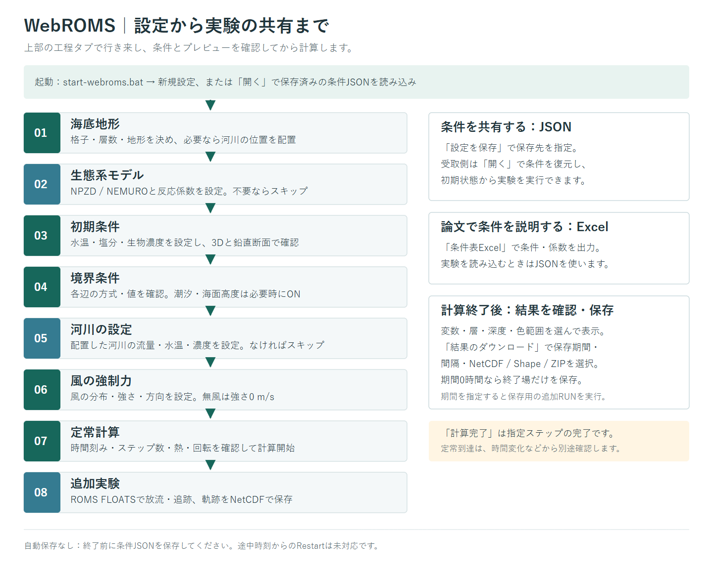

## 1. 起動する

1. リポジトリ、またはWindows配布ZIPをフォルダー全体で展開します。
2. `start-webroms.bat` をダブルクリックします。
3. ブラウザーが開いたら、そのまま操作します。起動ウィンドウは開いたままにしてください。

起動できない場合は [Windows起動ガイド](../WINDOWS.md) を参照してください。

## 2. まず同じ例を開いてみる

[ガイド用の条件JSON](examples/quickstart.json) をダウンロードし、画面上部の「開く」で選択してください。GitHubではファイルページの「Download raw file」からJSONを取得できます。Windows配布ZIPでは `docs/examples/quickstart.json` に同梱しています。

この例は操作を試すための理想化した湾形の閉鎖水槽です。24 × 20格子、鉛直6層、水深40～120 m、NPZD、夏季の模擬成層、河川1本、東向きの一様風3 m/s、簡易気温熱交換を設定しています。時間刻み10秒・120ステップなので、モデル時間20分の短い計算です。定常到達や実際の湾の再現を示す例ではありません。

初めから条件を作る場合は、07までで海洋場を計算し、必要に応じて08の粒子追跡へ進みます。上部の工程タブ、または「次へ」「戻る」で工程を移動できます。画面の値を変えたら、図と入力チェックを確認してください。

画面に収まらない項目は、左の設定欄や右の表示欄をスクロールすると確認できます。図のズーム操作と、設定欄のスクロールは別の操作です。

上部の入力チェックは「01 海底地形」などの工程名付きバーです。灰色は注意・警告なし、黄色は注意・警告、赤色は入力エラーを表します。クリックすると詳細が開きます。入力エラーがある間は計算できません。3D・平面と編集操作のツールバーは表示欄のスクロール中も固定されます。河川の設定工程では配置ツールを中央に、戻す・進めるを左端に表示します。

工程名は入力チェックバーにまとめ、操作中の工程は淡い緑の背景と上の緑色のバーで強調しています。さらに上の工程切り替えバーは文字なしで、ポインターを置くと工程名が表示されます。

地形・河川の操作は名前付きの枠に分かれ、戻す・進めるにも文字を付けています。水深の浅い側・深い側はツールバーで設定します。「地形を保存」「初期場を保存」は画面上部にあります。初期場のNetCDFを開く場合は、初期条件の「入力方法」を「NetCDFから読み込む」に変更してください。成層の式は「詳細」で開きます。潮汐・海面高度は新規条件ではOFFです。「戻る／次へ」は下側に固定されます。

定常計算の回転設定は、標準では緯度から計算します。β平面ではf₀とβ、f平面では一定のf₀とβ=0を使います。計算式は「詳細」で開きます。経過時間・ステップ数は上部の計算状態の横にあり、潮汐ON時は対応するUTC日時も表示します。3D・平面の切り替えと水平流速表示は主図内にあります。「鉛直位置」で層別・深度別を選べます。時系列ピンは主図・断面図のどちらからも配置でき、断面に含まれる地点は断面側にもマーカーを表示します。

初期条件は「物理項目」「生物項目」を順に切り替えて設定します。切り替えても入力値は保持されます。一様風の方位は円形ダイヤルの矢印で、風が吹いていく方向を選べます。結果の表示変数・高度な表示・鉛直位置はステップ数の横にあり、層別でもスライダーと数値入力で表層から何層目かを選べます。計算側の高度な設定は、コリオリと混合・拡散の下にまとめています。

海底地形では最初に「パッケージの地形を使う」か「その他の地形を使う」を選び、その下で格子数を設定します。計算結果の見出しの横にはアイコン付きで未計算・計算中・計算完了・停止・エラー・保存用RUNの状態が表示されます。「計算完了」は指定ステップ数の完了であり、定常到達の判定ではありません。

## 3. 海洋場の条件を設定する

### 01 海底地形

「計算格子」でX・Y格子数、格子間隔、鉛直層数を決めます。次に「地形の種類」と水深を選び、右側の図で形を確認します。

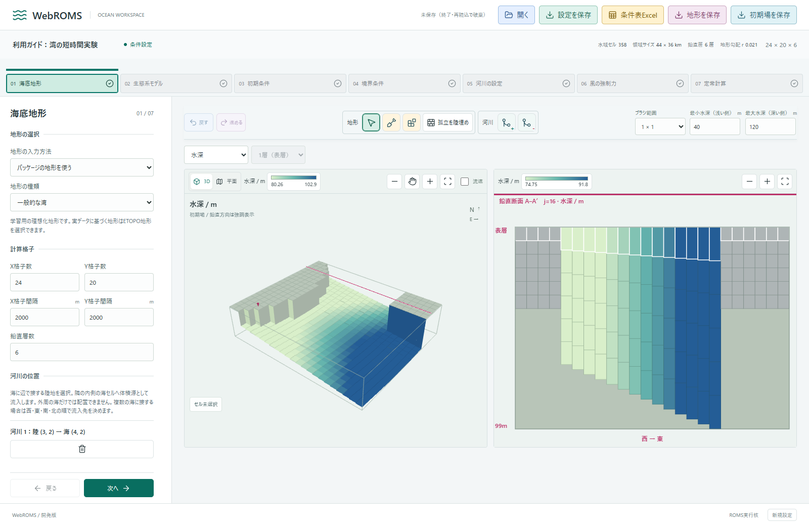

- 図を見るときは図のツールバーの矢印アイコン「参照」を選びます。拡大・縮小ボタンと、手のアイコン「移動」を使うと細部を見られます。移動をオフにすると3Dの回転に戻ります。
- 図のツールバーでスコップ「掘る」・ブロック「盛る」などを選び、隣のブラシ範囲を指定して図をクリックします。操作対象は淡い色とピンクの輪郭で表示されます。曲がった矢印「戻す」「進める」で編集履歴を移動できます。アイコンにポインターを置くと操作名が出ます。
- 「編集量（m）」は標準で最小水深と同じ値です。任意の値を入力でき、空欄にすると標準に戻ります。ブラシ範囲は水平セル数、編集量は水深の増減量で、鉛直層数には依存しません。「盛る」で最小水深未満になるセルは陸地化し、最小水深と同じなら海として残します。陸地を掘る場合も、最小水深未満の海セルは作りません。最大水深を超える掘削は最大水深で制限します。
- 編集中のカーソルはスコップ・ブロック・筆など、選んだツールの形に変わります。手のアイコンで移動に切り替えると、編集をせずに図を動かせます。
- 河川を使う場合はツールバーの「河川を追加」を選び、海に辺で接する陸セルを選びます。削除は「河川を削除」、または河川一覧の削除ボタンを使います。配置・削除は戻す・進めるに対応します。配置した河川の流量などは05で設定します。
- 地形の鉛直断面は隣に表示します。3D・平面上のピンクの線をドラッグすると断面位置が変わります。孤立水域がある場合は「孤立している箇所を陸埋めする」で外周に接しない水域を陸地にできます。外周と接続する水域がない場合は最大の水域を残します。この操作も戻せます。
- 自分の地形を使う場合は「地形をインポート」でShape ZIPまたは対応NetCDFを選びます。形式・座標条件は [地理入力の仕様](../OCEAN_INPUTS.md) を参照してください。

### 02 生態系モデル

物理と生物の両方を計算する場合は「計算する」を選び、NPZDまたはNEMUROを指定します。右側の反応図を選択すると、反応式・説明・係数を確認できます。

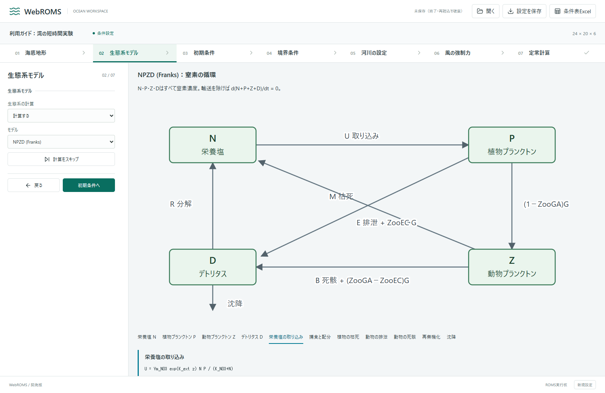

物理だけの実験では「計算をスキップ」を選択してください。生物濃度の初期分布は03、河川から入る生物濃度は05で設定します。

生態系の画面は循環図と反応の編集欄を並べています。図のブロック・矢印、または反応名を選ぶと、式・説明・関連パラメータを表示します。NPZDではスライダーと数値入力、取り込みの深度応答を同じ編集欄で確認できます。「全パラメーター」は研究用の数値編集一覧で、係数名・単位を検索できます。図側と一覧側は同じ設定へ同期します。「既定値」は選択した反応に関連する係数だけを戻します。表示する反応速度は初期設定による評価で、ROMSの計算結果の時系列ではありません。

### 03 初期条件

「初期分布」で一様、夏季の成層、冬季の混合、該当地域の平均値などを選びます。表示された水温・塩分などを設定し、3D図と隣の鉛直断面を確認します。

気候値やNetCDF、海面高度データを適用する間は「初期条件を補完中」と表示します。完了すると操作できる状態に戻ります。

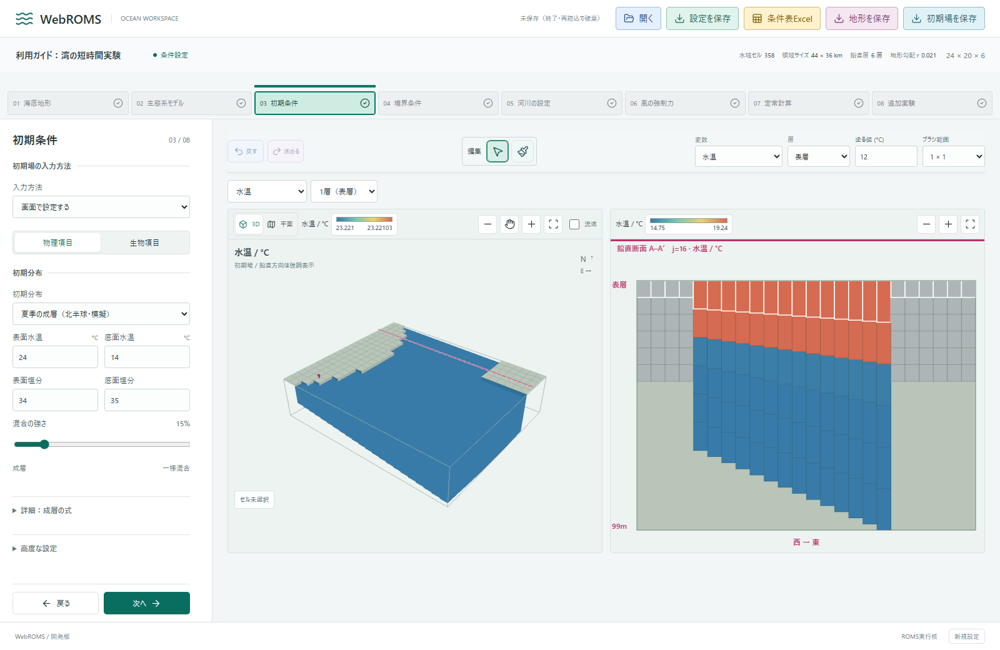

- 夏季・冬季の模擬分布では、表面・底面の値と混合の強さを変更できます。成層の式・躍層位置も表示されます。
- 生態系を有効にした場合は「生物濃度」で分布と基準濃度を確認します。気候値からの推定には換算・分布の仮定があります。画面の出典・説明も確認してください。
- 一部の格子を修正するときは図のツールバーで変数・層・値・ブラシ範囲を選び、筆アイコン「塗る」を選択します。閲覧するときは矢印アイコン「参照」に戻します。戻す・進めるも同じツールバーにあります。
- 3D・平面のカラーバーと、隣の鉛直断面のカラーバーは独立しています。それぞれクリックすると色範囲・色の種類を変更できます。
- 両図の上部に変数名・単位付きのカラーバーと拡大・縮小ボタンを揃えています。自動範囲は「四分位範囲」または「最小〜最大」を選べます。水域セル数などは上部の格子サイズ付近に小さく表示します。
- 初期場NetCDFの読み込み・保存にも対応します。条件一式を他者に渡す場合は、画面上部の「設定を保存」で条件JSONを作成してください。

### 04 境界条件

設定する辺を選び、境界方式と図を確認します。新規設定の境界値は、境界に近い初期場の水温・塩分・生物濃度から設定されます。

ガイド用JSONでは、閉じた水槽として全辺を「閉鎖」にしています。外と接続する実験を作る場合は「値を設定」などの方式を選んでください。

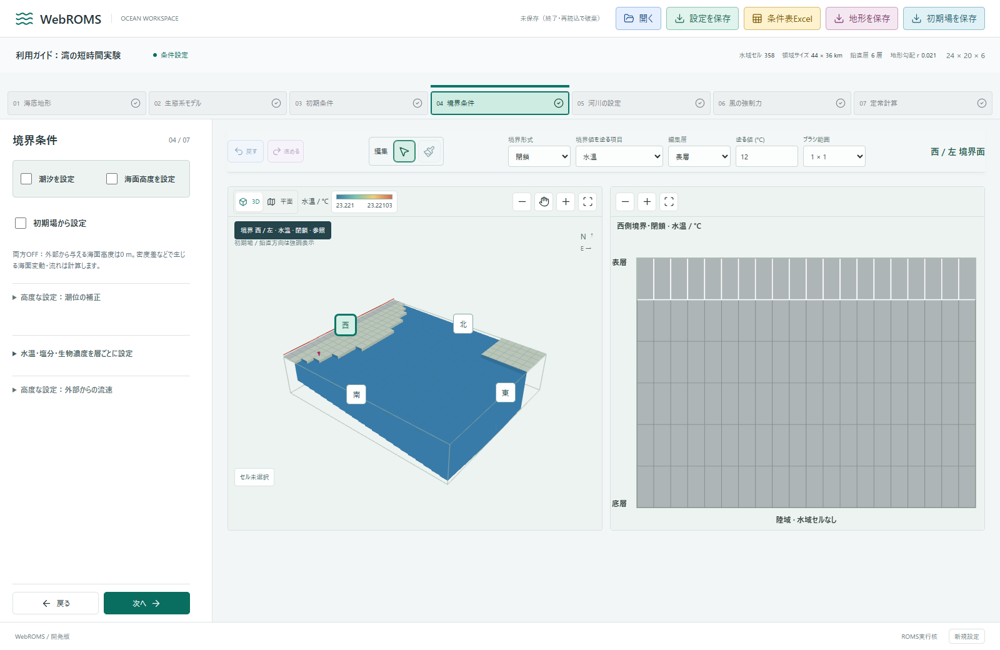

- 海とつながる境界には「値を設定」、閉じた水槽には「閉鎖」など、実験に合った方式を選びます。海のない辺は自動で閉鎖されます。
- 3D図の西・東・北・南のマーカーで設定する側面を選びます。境界方式（閉鎖・値を指定など）は編集バーで切り替えます。「初期場から設定」のチェックを付けると、選択した側面に現在の初期場を反映します。手動で変更するときは編集バーの対象変数・層・値を選び、筆アイコンで塗るか、層ごとの設定を開きます。図のカラーバーをクリックして色範囲を変更できます。
- 「潮汐を設定」「海面高度を設定」は必要な場合にチェックします。両方OFFなら、外部から与える海面高度強制は0 mです。モデル内部の海面変動は計算されます。
- 地理座標がある場合でも、潮汐の実データが未読込なら理想化潮汐を使います。適用される出典・設定を確認してください。

### 05 河川の設定

01で配置した各河川の流量・水温・塩分、生態系を使う場合は流入濃度を設定します。05は3D／平面表示のみで、断面表示はありません。

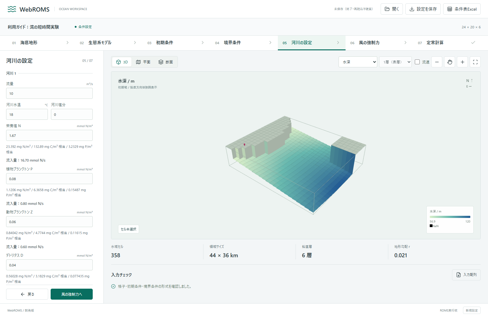

河川を配置していない場合も「次へ」で進めます。図のツールバーから参照・追加・削除・戻す・進めるを操作できます。閉鎖水槽への河川流入は水位を上げるため、境界方式との組合せも確認してください。

図中の矢印は河口の陸地から、流入先の海セルへ向かいます。「流入方向（流入先）」で隣接する内部水域セルを選び直せます。陸地・斜めのセル・外周セルは選べません。変更は条件JSONに保存され、戻す・進めるにも対応します。これは河川の体積源を入れるセルの変更であり、水平の噴流速度を強制する設定ではありません。

### 06 風の強制力

風の分布を選びます。一様風では強さをスライダー、吹いていく向きを角度で指定し、右側の矢印で分布を確認します。

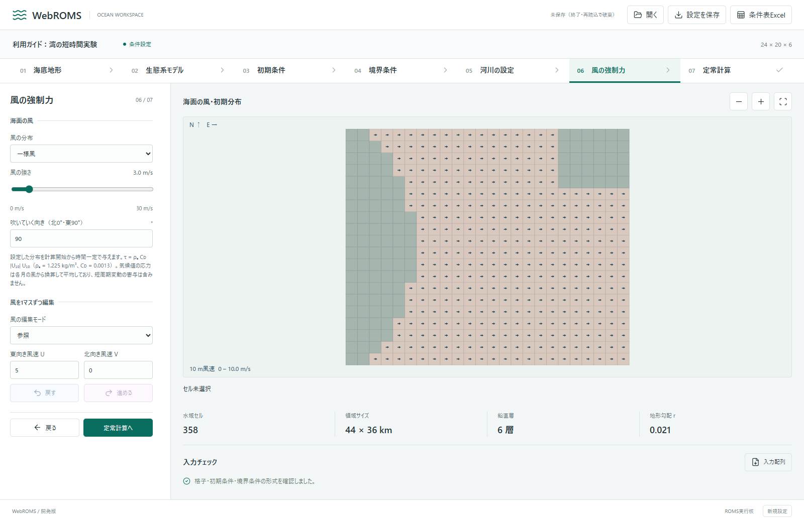

方向は北0°・東90°です。「風が来る方向」ではなく「吹いていく方向」を指定します。無風にしたい場合は一様風の強さを0 m/sにします。1セルだけ修正する場合は風の図のツールバーでU・Vと筆アイコン「設定」を選びます。参照・元の分布に戻す・戻す・進めるも同じ場所にあります。

### 07 定常計算

プロジェクト名の横に計算状態、モデル時間、ステップ数、整数の完了率を表示します。「計算中」の状態表示はここにまとめ、図の周囲には重複して表示しません。

時間刻みと計算ステップ数を確認します。計算するモデル時間は「時間刻み × ステップ数」です。熱の与え方、混合・拡散、コリオリ力も確認して「定常計算を開始」を押します。

時間積分の下には計算期間の日数・累計時間と開始日・終了日（UTC）を表示します。「潮汐の情報」を開くと、東・西・南・北の各境界の平均潮位を４色の時系列で確認できます。拡大・縮小・全期間表示のボタンを使い、拡大後は矢印・スライダー・ドラッグで期間を移動します。マウスホイールでも拡大・縮小できます。閉鎖・周期境界と陸域は除外し、MDTやユーザーの潮位補正はこのグラフに含みません。大潮・小潮相当の表示は各地点の潮差からの目安です。理想化潮汐の場合は実地点の予測ではありません。

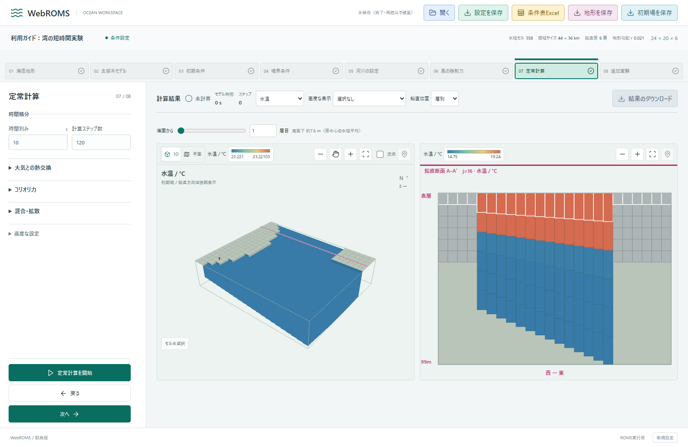

熱は「なし」「気温から計算」「熱フラックスを直接指定」のどれか一つを選びます。通常の鉛直混合はGLSで計算され、一定値にしたい場合は高度な設定を開きます。

大きい格子や長時間の実験に進む前に、小さい条件で動作を確認してください。入力チェックにエラーがある場合は該当条件を直します。「計算完了」は指定ステップ数を実行した意味で、定常到達は時間変化などから確認します。

## 4. 結果を見る

表示する変数を選び、層別ではバーと数値入力で層を選びます。必要なら「流速」をチェックします。3D・平面を切り替え、隣の鉛直断面と比較できます。カラーバーをクリックすると、色の種類と上下限のスライダーを表示できます。熱交換・コリオリ・混合／拡散は、見出しをクリックして設定欄を開きます。

自動範囲は選択中の層全体の有効な海セルの25～75%です。全ての最小値・最大値まで表示したい場合は手動で上下限を変えます。GLSの鉛直拡散係数は計算開始後に選択できます。欠測がないときは欠測の凡例を表示しません。

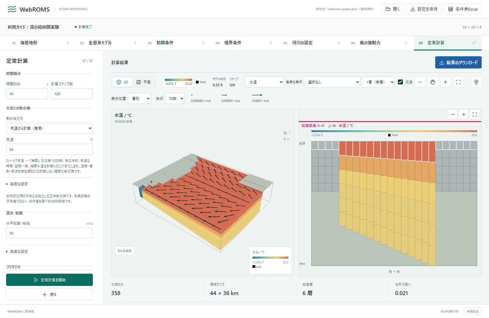

実際の深さで見る場合は「表示位置」を「深度別」に切り替えます。スライダーまたは数値入力で海面下の深さを指定すると、層間を補間した値を表示します。

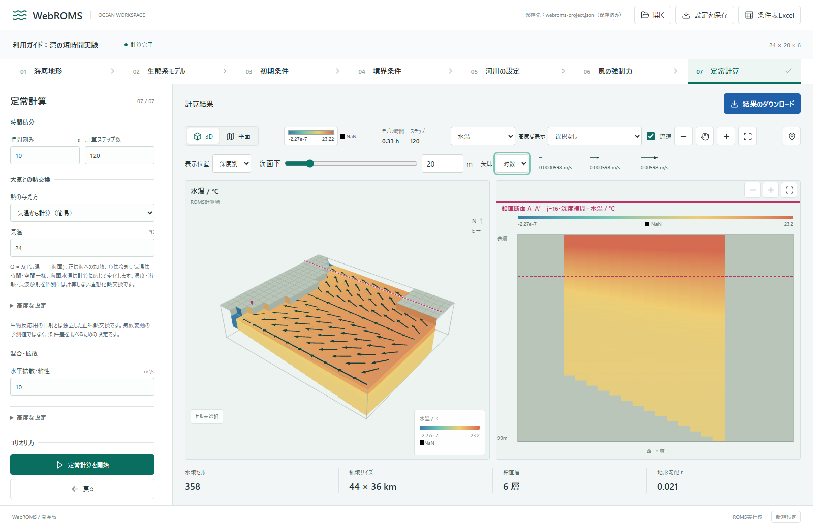

ピンのアイコンをオンにして海セルを選ぶと、直近の時系列を確認できます。保持されている期間だけを表示します。計算を長く続けて時間変化を確認する用途に使ってください。

## 5. 条件を保存して、別の端末で開く

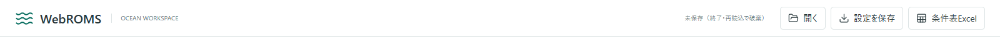

1. 「設定を保存」をクリックし、OSのダイアログで保存先とファイル名を指定します。
2. 保存した `.json` を他の利用者に渡します。
3. 受取側は同じWebROMS配布版を起動し、「開く」でそのJSONを選びます。
4. 復元された各工程の条件を確認して、計算します。

| ファイル | 使い方 |
| --- | --- |
| 条件JSON | 条件一式の保存・復元・共有。実験を初期状態から実行するために使います。 |
| 条件表Excel | 論文・報告書で条件や係数を説明するために使います。アプリの設定読み込みにはJSONを使います。 |
| NetCDF | 初期場などの入力、計算結果の数値データ。3次元の水温・塩分・生物濃度などを扱います。 |
| Shape ZIP | 地形などの2次元入力、結果の選択した水平層の保存に使います。 |

ブラウザーには自動保存されません。終了・再読み込み前にJSONを保存してください。保存先を指定せずキャンセルした場合は保存しません。JSONで条件を復元しても、計算終了時刻の状態から続きを実行するRestartにはなりません。

**独自地形もJSONだけで配布できます。** 自分で用意したShape／NetCDFを読み込んだ後に「設定を保存」すると、計算格子へ変換した水深・陸域・座標範囲もJSONに含まれます。受取側は同じWebROMS配布版でJSONを開くだけでよく、元の地形ファイルは不要です。元データの全解像度・属性や計算結果は含みません。JSONは50 MB以下にしてください。公開・共有の際は元データの再配布条件を確認してください。

## 6. 計算結果を保存する

「結果のダウンロード」で追加RUN期間・保存間隔・形式を選びます。

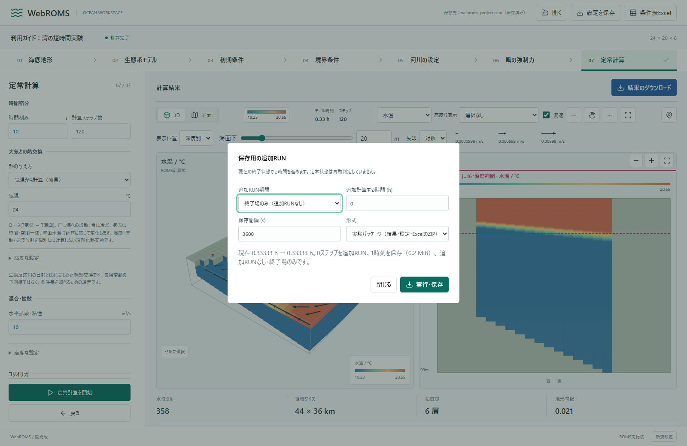

1. 終了時点の結果だけなら「終了場のみ（追加RUNなし）」を選びます。
2. 一定期間を保存したい場合は追加RUN期間と間隔を指定します。現在の終了状態からさらに時間を進め、その区間を保存します。
3. 「実行・保存」を押し、保存先を指定します。期間を指定した場合は追加RUNの完了を待ちます。

| 形式 | 保存する内容 |
| --- | --- |
| 実験パッケージ | 結果NetCDF・条件JSON・論文用条件表Excel・配布版の識別情報をまとめたZIP。 |
| NetCDF（単一ファイル） | 選んだ区間の数値データを一つのファイルに保存。 |
| NetCDF（時刻別ZIP） | 時刻ごとの3D数値データをZIPにまとめて保存。 |
| Shape | 選んだ水平層の2次元データを時刻別ZIPに保存。 |

通常計算中は結果ファイルを自動保存しません。過去の通常RUN全体をさかのぼって保存する機能ではありません。条件を共有するだけなら条件JSONを渡せばよく、Excel・計算結果は目的に合わせて添付してください。

## 7. 追加実験で粒子を追跡する

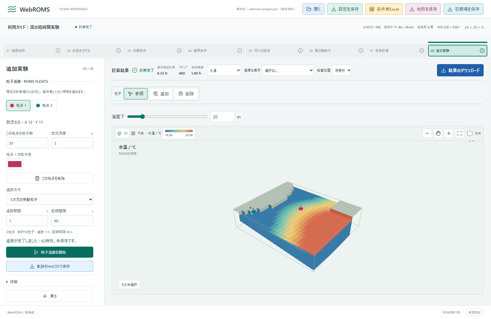

1. 07の計算終了後、「次へ」で08を開きます。海洋場の状態は引き継がれます。
2. 粒子ツールバーの「追加」を押し、3Dまたは平面図の内部水域セルをクリックします。続けてクリックすると複数地点を追加できます。陸域と外周セルは選べません。
3. 地点ボタンを選び、地点ごとの粒子数・放流深度・色を指定します。座標がある地形では放流セルの緯度経度も表示します。追跡方式・期間・記録間隔を設定し、「粒子追跡を開始」を押します。
4. 追跡後、「軌跡をNetCDFで保存」で保存先を指定します。自動保存はしません。

08の時間表示は「海洋場の計算」と「追加実験」を分けて表示します。元の海洋場は保持し、各粒子実験は同じ海洋計算終了時点から始まります。追加実験側の時間表示は実施した実験時間の合計で、07のモデル時間を進めません。NetCDFの時刻は固定開始時点から今回の実験終了までのモデル経過秒です。

状態を受け渡すための一時NetCDFと補助データは、追加実験の終了時に破棄します。再実験では保持した07の同じ終了場を再び一時保存して読み込みます。これはデータの受け渡しだけで、07の再計算ではありません。

潮汐強制がある場合、固定開始時点から約24.84時間の１周期を切り出し、同じ波形・振幅を繰り返します。始点・終点の潮位差を線形に除いて継ぎ目を連続にする理想化です。実際の大潮・小潮の時間変化をそのまま再現するものではありません。潮位補正がある場合は補正込みの波形を繰り返し、MDTは維持します。開始時点以降に１周期分の元データが必要です。07の終了状態をブラウザー内の一時NetCDFから直接読み込むため、初期条件からの再計算は行いません。一時データは終了・再読み込み・新しい計算で破棄され、利用者のフォルダーには保存しません。

粒子ツールバーの「削除」を選び、図内の放流ピンまたはセルをクリックすると地点を削除できます。「参照」で図の移動・回転操作へ戻ります。水深を選択すると3D表示へ切り替わり、粒子はそれぞれの実際の深度に対応した位置に表示されます。

3次元受動粒子は海洋場の3次元流れに従います。一定深度方式は基準海面からの深度を維持します。粒子は各放流セル内に分散して放流され、乱数による拡散や魚の行動は含みません。粒子と放流ピンは地点ごとの同じ色で表示し、軌道線は表示しません。放流ピンは丸頭と番号、河川は別形状のマーカーです。計算後の色変更も可能です。

NetCDFにはモデル経過秒、粒子番号、放流元番号、元の放流位置、格子座標、深度、状態を保存します。地点ID・セル・粒子数・色も記録します。緯度経度がある地形では、各放流地点と粒子の緯度経度を収録します。

追跡中は海洋計算も時間を進めます。再度放流しても、保持した07の終了状態から開始します。条件JSONは放流条件も保存しますが、計算済み状態は含まないため、別セッションで読み込んだ後は07を計算する必要があります。

## 画面と図の更新

スクリーンショットは2026年10月13日の実装を、ガイド用条件で撮影しました。OSの保存先ダイアログは画像に含めていません。画像内の20分の結果は操作説明用です。

開発者はビルド後に `node scripts/capture-user-guide.mjs` を実行すると、各工程の撮影と条件JSONの更新、JSON再読み込み・短時間計算・Excel出力・結果ZIPの確認を実行できます。Chromeと開発依存関係が必要です。設定フロー図の編集用原本は [setup-flow.svg](images/setup-flow.svg) です。
# 河川の選択と編集

05河川では、参照モードで図中の河口マーカーまたは流入先セルをクリックすると、その河川の設定欄に移動します。選択した河川のマーカー・流入方向の矢印・設定欄を赤系でハイライトします。設定欄のクリックやキーボード操作でも図の選択が同期します。回転や移動のドラッグ、追加・削除モードでの操作では編集欄への移動を行いません。

# 計算完了・中止からの操作

07で計算が完了すると「定常計算を開始」は灰色で無効になります。青い「再計算」から「再計算しますか？」に同意すると、現在の条件で初期場からやり直します。キャンセルした場合は終了場を保持します。

計算中に「計算停止」を押すと、安全なステップ区切りで止まり、「計算再開」と「再計算」が表示されます。「計算再開」は中止時の海洋場・乱流混合・モデル時刻・潮汐位相をそのまま引き継ぎ、元の目標ステップ数まで続けます。条件を編集した後に再開するときは、中止時の条件へ戻す確認が表示されます。変更条件を使いたい場合は「再計算」を選びます（初期場から開始）。中止場はブラウザメモリ内のみで保持し、再読み込みや終了後には再開できません。設定JSONは条件の保存であり、計算途中のRestart保存ではありません。

# 日本の潮汐データ

04の「潮汐を設定」をONにして「日本の同梱潮汐データを適用」を押すと、`TidalData_jp.csv`から取り込んだ239地点の主要4分潮（M2・S2・K1・O1）を使えます。地形に緯度経度が必要です。近傍3地点の複素調和定数を距離の逆二乗で重み付けして内挿・外挿します。100 km以遠でも生成しますが、外挿参考値として警告します。日本の値を海外へ外挿しても、その海域の潮汐を再現するものではありません。海峡や陸地をまたぐ地点選択は自動判別しないため、「潮汐の情報」のiボタンで採用地点・距離・振幅・遅角を確認してください。

鉛直断面図の上の「潮汐を表示」で、選択中の西・東・南・北境界だけの平均潮位を表示します。グラフは画面内に表示し、ポップアップは使いません。初めは72時間分で、拡大・縮小ボタンで期間を変更できます。使用データ一覧もその場で展開できます。水温・塩分などの操作中でも表示設定を保持します。

倍率と時間移動は編集ツールバーから調整し、選択境界に適用します。操作中のグラフにも反映します。正の時間移動は波形を遅らせます。角の水域セルは隣接する両境界で同じ潮位を共有するため、そのセルの補正は両境界に影響します。通常の倍率範囲では縦軸を固定します。MDTとユーザーの時系列残差補正はグラフに含みません。

「高度な設定：平均振幅・遅角・セル別・追加分潮」では選択境界の複素平均の振幅・遅角を確認・補正できます。表示値は倍率・時間移動を適用する前の値です。複素係数の平均との差を各セルに加算するため、空間偏差を残して平均を指定値に合わせます。359°と1°のような遅角も正しく平均化します。全境界を選ぶと入力値を全セルへ一様に指定します。個別セルの入力もできます。「振幅・遅角を入力補正」を適用したセルについてのみ遠距離外挿の警告を解除します。補正済みでも精度を保証するものではなく、元データの出典は残ります。倍率や位相を動かすだけでは警告は解除しません。

追加分潮は `名前,速度（度/時）,振幅（cm）,遅角（度）` を1行ずつ入力します。例えば `N2,28.4397295,10,0` や `M4,57.9682084,2,0`。主要4分潮と名前を重複させず、速度は0より大きく180以下とします。空欄で適用すると、その対象セルの追加分潮を削除します。追加分潮も条件JSONに保存されます。

これは公表調和定数を用いた**実験用近似**です。計算開始を位相基準として `η = Σ A cos(ωt − g)` で合成し、天文引数・節点補正は省略しています。暦に対応する気象庁の予測潮位ではありません。平均水位・潮位表基準面は加算しないため、MDTを二重加算しません。適用後の条件JSONには時系列と採用地点の調和定数を含むため、元CSVなしで共有できます。

参照：[気象庁の潮位表地点一覧](https://www.data.jma.go.jp/kaiyou/db/tide/suisan/station.php)、[潮位表の解説](https://www.data.jma.go.jp/kaiyou/db/tide/suisan/explanation.html)。同梱CSVはユーザー提供ファイルで、各地点の掲載年次はデータ一覧に表示します。
# 地形のファイル入出力

「地形を保存（shp/nc）」はZIPを保存します。同じZIPに従来ROMS形式の `roms_grd.nc`、格子ポリゴンの `terrain.shp`、等深線の `depth_contours.shp` と各Shapeの `.shx/.dbf/.prj/.cpg` を含めます。QGISでは展開後に各 `.shp` を開いてください。等深線は編集後の計算格子から生成したもので、測量原図ではありません。地形NetCDFだけでは従来ROMSの実験設定一式にはなりません。

外部Shape入力は水深属性 `DEPTH_M` または `DEPTH` を持つポリゴンに対応します。同名の `.shp/.dbf/.prj` をまとめて選択するか、ZIPにしてください。等深線だけから地形を生成する入力は未対応です。保存したWebROMSのZIPはそのまま地形として再入力できます。

従来ROMSの地形NetCDFはclassic／64-bit offset形式の `h`、`lon_rho/lat_rho`、任意の `mask_rho` に対応します。曲線格子は直交格子へ補間し、元の格子範囲外は陸域として警告します。NetCDF4/HDF5はclassicへ変換してください。緯度経度のない理想化地形の保存NetCDFには、架空の緯度経度を付けません。その場合のWebROMSへの再入力には同梱のZIPを使用してください。
